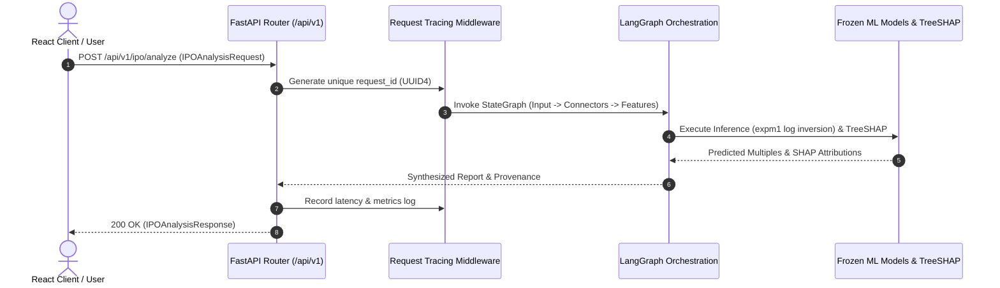

# Production FastAPI API Specification & Service Contract

## 1. Overview & Versioning
The **FastAPI API Layer** exposes versioned endpoints under `/api/v1/` to serve real-time pre-IPO subscription forecasts, SHAP additive explanations, category recommendations, risk audits, and field-level provenance.

Base URL: `http://localhost:8000/api/v1`

---

## 2. API Endpoints Catalog

| Method | Path | Description | Request Payload | Response Contract | Status Codes |
|---|---|---|---|---|:---:|
| `POST` | `/api/v1/ipo/analyze` | Execute complete Agentic AI forecast, SHAP attribution, category ranking, and risk audit. | `IPOAnalysisRequest` | `IPOAnalysisResponse` | `200`, `400`, `422`, `500` |
| `GET` | `/api/v1/health` | Lightweight dependency check returning API, model registry, and connector status. | *None* | `HealthResponse` | `200` |
| `GET` | `/api/v1/models` | Retrieve frozen model versions, validation moments, and test metrics. | *None* | `ModelMetadataResponse` | `200` |
| `GET` | `/api/v1/schema` | Retrieve parameter descriptions, types, and defaults for React form builders. | *None* | `Dict[str, Any]` | `200` |

---

## 3. Request & Response Lifecycle



---

## 4. Structured Error Handling & Status Codes

All errors are returned in a uniform JSON schema without leaking raw internal stack traces:

```json
{
  "request_id": "c4b78a90-3b4c-4e89-9a2f-123456789abc",
  "error_code": "INVALID_IPO_INPUT",
  "message": "IPO input failed pre-flight structural validation.",
  "details": {
    "errors": [
      "price_low (520.0) cannot exceed price_high (500.0)"
    ]
  }
}
```

### Standard Error Codes:
- `400 BAD REQUEST` (`INVALID_IPO_INPUT`): Price band violations, non-positive issue size, or illogical terms.
- `422 UNPROCESSABLE ENTITY` (`PYDANTIC_VALIDATION_ERROR`): Missing required fields or schema type mismatches.
- `500 INTERNAL SERVER ERROR` (`INTERNAL_SERVER_ERROR`): Unhandled system exception.

---

## 5. Request Tracing & Observability
- Every request is tagged with a UUID4 `request_id` passed in both the response body and the structured JSON logs.
- In-process metrics track total requests, error rates, average latency, and temporal rejections accessible via `GET /api/v1/health`.

---

## 6. CORS Policy
- Configured via `backend/config.py` (`settings.cors_origin_list`).
- Development defaults to localhost origins (`http://localhost:3000`, `http://localhost:5173`, `http://localhost:8000`).
