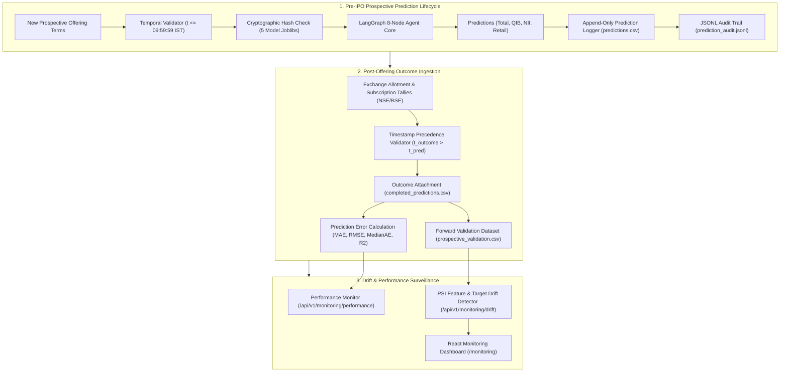

# Prospective Real-IPO Validation & Prediction Logging Architecture

## 1. System Architecture

---

## 2. Immutability & Separation of Concerns
1. **Original Prediction Immutability**: All prospective forecasts are written to `data/live_predictions/predictions.csv` with a unique UUID `prediction_id`, cryptographic feature snapshot hash, and timestamp. Original forecast multiples are never modified.
2. **Outcome Isolation**: Exchange closing tallies are stored in `completed_predictions.csv` and attached only when $t_{\text{outcome}} > t_{\text{prediction}}$.
3. **No Automatic Retraining**: If PSI indicates moderate or high feature/target drift, the engine flags `model_status = "MODEL_REVIEW_REQUIRED"`. Frozen models in `models/final_candidates/` remain active and unchanged.
