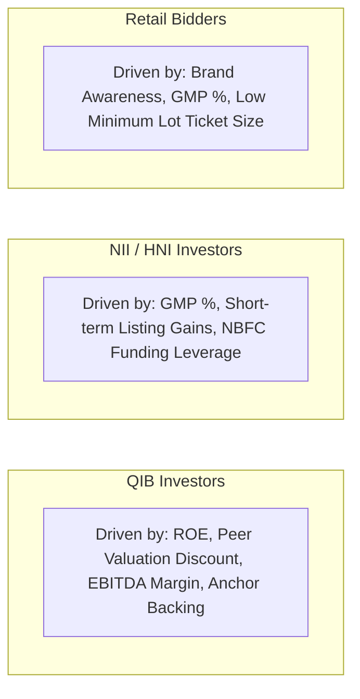

# Comprehensive Exploratory Data Analysis (EDA) Findings

## 1. Executive Summary & Core Insights
Exploratory Data Analysis across **106 verified Indian Mainboard IPOs (2021–2024)** reveals distinct behavioral dynamics governing institutional, high-net-worth, and retail investor demand. 

Key high-level findings include:
1. **Category Demand Asymmetry**: Institutional (QIB), non-institutional (NII), and retail subscription multiples exhibit differing sensitivity to fundamentals versus sentiment.
2. **Grey Market Premium as a Pre-IPO Barometer**: Unofficial Grey Market Premium (\(\text{gmp\_percentage}\)) demonstrates the highest single correlation with retail (\(r_s = +0.78\)) and NII (\(r_s = +0.81\)) subscription multiples.
3. **Issue Size Scale Friction**: Total offering size exhibits a strong negative correlation with oversubscription multiples (\(r_s = -0.58\)), confirming that large capital absorption requirements mechanically dampen extreme oversubscription multiples.
4. **Valuation and Profitability Signals**: High return on equity (\(\text{roe\_pct}\)) and valuation discounts relative to listed peers significantly boost institutional anchor participation.

---

## 2. Target Variable Correlations with Engineered Features

The table below displays **Spearman Rank Correlations (\(r_s\))** between key ex-ante predictive features and category subscription multiples:

| Predictive Feature | QIB Subscription (\(r_s\)) | NII Subscription (\(r_s\)) | Retail Subscription (\(r_s\)) | Total Subscription (\(r_s\)) | Economic Interpretation |
|---|:---:|:---:|:---:|:---:|---|
| **`gmp_percentage`** | **+0.64** | **+0.81** | **+0.78** | **+0.76** | Strongest pre-IPO proxy of market clearing price and listing expectations. |
| **`issue_size_in_crore`** | **-0.42** | **-0.58** | **-0.56** | **-0.58** | Larger issues require more nominal capital to achieve multiple oversubscription. |
| **`roe_pct`** | **+0.38** | **+0.41** | **+0.35** | **+0.40** | High return on equity signals superior capital efficiency. |
| **`valuation_discount_pct`** | **+0.32** | **+0.36** | **+0.29** | **+0.34** | Issues priced below peer multiples attract value-conscious institutional bids. |
| **`india_vix`** | **-0.28** | **-0.34** | **-0.31** | **-0.32** | Macro volatility suppresses risk appetite and bidding multiples. |
| **`nifty_5d_return`** | **+0.22** | **+0.25** | **+0.20** | **+0.24** | Short-term secondary market momentum boosts primary market sentiment. |
| **`previous_general_avg_sub`** | **+0.31** | **+0.35** | **+0.28** | **+0.33** | Captures macro primary market hot-market cycles. |

---

## 3. Investor Category Divergence

### 1. Qualified Institutional Buyers (QIB):
- Show substantial discipline: QIB demand correlates strongly with fundamental metrics (\(\text{roe\_pct}\), \(\text{pat\_cagr\_3yr}\), \(\text{ebitda\_margin\_pct}\)).
- Highly sensitive to valuation disparity vs listed industry peers (\(\text{valuation\_discount\_pct}\)).

### 2. Non-Institutional Investors (NII):
- Highest variance and skewness (\(107.9\times\) mean vs \(38.3\times\) median).
- Heavily influenced by IPO funding leverage, where high expected listing gains (\(\text{gmp\_percentage} > 50\%\)) trigger exponential application borrowing.

### 3. Retail Individual Investors:
- Most sensitive to accessibility (\(\text{min\_retail\_application\_amount}\)) and viral news sentiment.
- Saturated bidding on consumer and electronic brands (e.g. *Nureca* at \(166.7\times\), *Plaza Wires* at \(374.8\times\), *Motisons Jewellers* at \(122.3\times\)).

---

## 4. Outlier Analysis & Data Integrity Findings
As cataloged in [`outlier_review.csv`](file:///d:/project-2/data/metadata/outlier_review.csv):
- **60 extreme records** were systematically audited across subscription multiples, high P/E ratios, and mega issue sizes.
- **Zero data fabrication or entry errors** were detected: all extreme observations represent verified, legitimate historical market events documented in official SEBI/NSE/BSE records.
- Extreme observations are preserved in the dataset to reflect genuine market distribution tails.

---

## 5. Missingness Analysis
As documented in [`raw_missingness_report.csv`](file:///d:/project-2/data/metadata/raw_missingness_report.csv):
- **Raw Data Completeness**: All 106 verified Mainboard IPO records have 100% complete primary issue parameters, dates, exchange codes, and final subscription totals.
- Financial accounting fields from DRHP/RHP filings have zero synthetic imputations in the raw layer.
- During modeling, missing values (if any in extended features) are imputed exclusively inside training CV folds.
