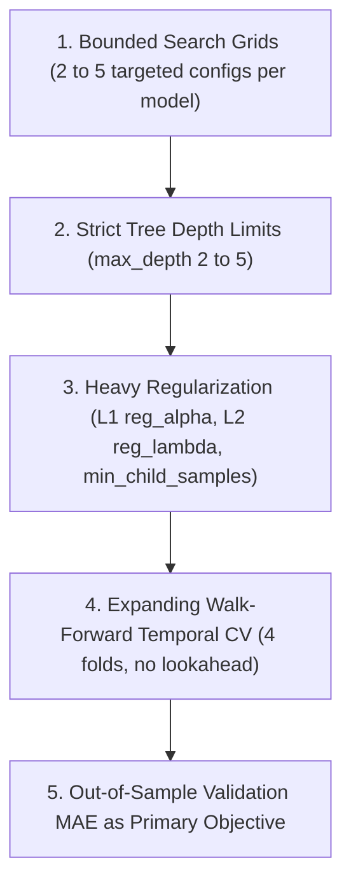

# Hyperparameter Search Policy & Overfitting Prevention

## 1. Context & Sample Size Constraints
In empirical financial machine learning with modest sample sizes (\(N=89\) development IPOs), unrestricted large-scale hyperparameter searches risk severe data mining bias, hyperparameter overfitting, and brittle decision boundaries. 

To govern hyperparameter tuning responsibly, this policy outlines the bounded search strategy employed in Phase 7.

---

## 2. Search Strategy Principles

### Principle 1: Bounded Search Grids
- Search grids are restricted to small, disciplined candidate sets (4–5 configurations per model family) focusing on tree depth, learning rate shrinkage, and regularization penalties.

### Principle 2: Shallow Tree Architecture
- Maximum tree depth is constrained:
  - **XGBoost**: `max_depth` \(\in \{2, 3, 4\}\)
  - **LightGBM**: `max_depth` \(\in \{2, 3\}\), `num_leaves` \(\in \{4, 7\}\)
  - **Random Forest**: `max_depth` \(\in \{3, 4, 5\}\)
- Deep trees (\(\text{depth} \ge 6\)) are prohibited to prevent memorization of idiosyncratic IPO instances.

### Principle 3: Explicit Regularization
- Subsampling (\(\text{subsample} \in [0.7, 0.85]\)) and column sub-sampling (\(\text{colsample\_bytree} \in [0.7, 0.8]\)) are enforced for every boosted tree.
- L1 (\(\alpha\)) and L2 (\(\lambda\)) regularization terms are mandated in XGBoost and LightGBM configurations to shrink noisy regression coefficients.

### Principle 4: Walk-Forward Temporal Cross-Validation
- Candidate configurations are evaluated exclusively across 4 expanding walk-forward temporal folds on the 89 development IPOs.
- Random K-fold cross-validation is strictly forbidden.

---

## 3. Search Space Specification

| Model Family | Hyperparameters Tuned | Range / Search Values | Rationale |
|---|---|---|---|
| **XGBoost** | `n_estimators`, `max_depth`, `learning_rate`, `subsample`, `colsample_bytree`, `reg_alpha`, `reg_lambda`, `min_child_weight` | `n_est`: 60–120 `max_depth`: 2–4 `lr`: 0.02–0.05 `alpha`: 0.1–1.0 `lambda`: 1.0–2.0 | Prevents gradient explosion; stabilizes leaf weights on small subsamples. |
| **LightGBM** | `n_estimators`, `max_depth`, `num_leaves`, `learning_rate`, `subsample`, `colsample_bytree`, `min_child_samples`, `reg_alpha`, `reg_lambda` | `n_est`: 60–120 `max_depth`: 2–3 `num_leaves`: 4–7 `min_child`: 5–10 | Restricts tree complexity and leaf count for robust generalization. |
| **Random Forest** | `n_estimators`, `max_depth`, `min_samples_split`, `min_samples_leaf`, `max_features`, `bootstrap` | `n_est`: 80–150 `max_depth`: 3–5 `min_samples_leaf`: 2–3 `max_features`: 'sqrt', 0.6–0.8 | Smooths out high-variance predictions via bagging aggregation. |
