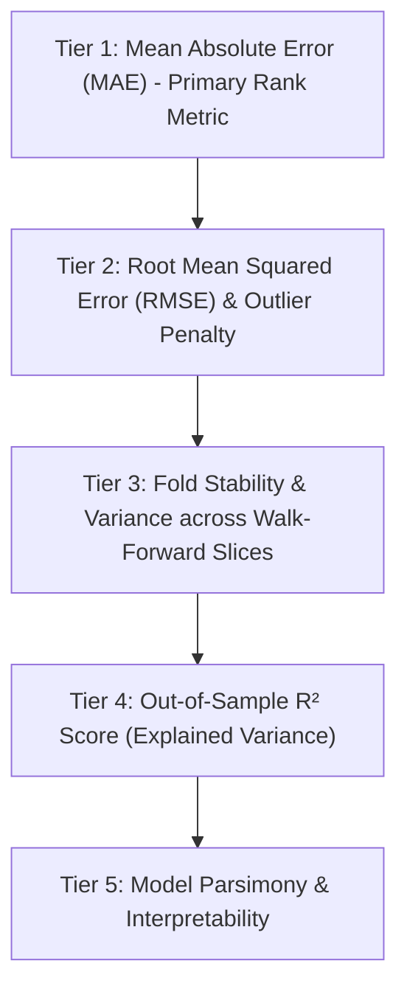

# Model Selection Policy & Evaluation Protocol

## 1. Core Principles & Governance
This document establishes the formal model selection rules for pre-IPO subscription prediction on the Indian Mainboard dataset.

To ensure scientific rigor and prevent empirical overfitting, the model evaluation protocol adheres strictly to the following principles:

1. **Strict Test Set Quarantine (17 Final IPOs Unused)**:
   - The chronologically final **17 IPOs (Feb 2024 – Jul 2024)** are strictly quarantined.
   - Zero decisions regarding model architectures, target transformations, feature group inclusions, or regularization hyper-parameters may be made using the test set.
   - The test set is reserved exclusively for final forward evaluation after model finalization in subsequent phases.

2. **Temporal Integrity**:
   - Model selection must be conducted exclusively via expanding-window **walk-forward cross-validation** across historical development data (89 IPOs).
   - Preprocessing (imputation, categorical encoding, feature scaling) is fitted strictly inside each temporal training fold.

---

## 2. Multi-Tiered Evaluation Hierarchy

Model performance is ranked using a structured multi-criteria decision hierarchy:

### Tier 1: Primary Metric — Mean Absolute Error (MAE)
- Evaluated strictly on the **original subscription multiple scale** (\(\text{times}\)).
- For models trained on \(\log(1+y)\), predictions are inverted via \(\hat{y} = \operatorname{expm1}(\hat{\tilde{y}})\) before metric calculation:
  \[
  \text{MAE} = \frac{1}{N} \sum_{i=1}^{N} |y_i - \hat{y}_i|
  \]
- Rationale: Directly reflects expected prediction error in real subscription units without disproportionate skew from single extreme tail events.

### Tier 2: Secondary Metric — Root Mean Squared Error (RMSE)
- Penalizes large catastrophic forecasting errors:
  \[
  \text{RMSE} = \sqrt{\frac{1}{N} \sum_{i=1}^{N} (y_i - \hat{y}_i)^2}
  \]
- If two candidate models have comparable MAE (\(\Delta \text{MAE} < 5\%\)), the model with lower RMSE is preferred.

### Tier 3: Walk-Forward Fold Stability
- Standard deviation of fold-level MAE across all 4 walk-forward validation splits:
  \[
  \sigma_{\text{fold\_MAE}} = \sqrt{\frac{1}{K-1}\sum_{k=1}^{K} (\text{MAE}_k - \overline{\text{MAE}})^2}
  \]
- A model showing consistent low error across all market epochs (2021 bull run, 2022 bear market, 2023 recovery) is favored over a model with erratic performance driven by one lucky fold.

### Tier 4: Supporting Metric — Out-of-Sample \(R^2\)
- Measures proportion of variance explained vs naive historical mean baseline:
  \[
  R^2 = 1 - \frac{\sum_i (y_i - \hat{y}_i)^2}{\sum_i (y_i - \bar{y})^2}
  \]

### Tier 5: Parsimony & Simplicity
- Where performance differences between complex gradient-boosted ensembles and regularized linear models are statistically negligible, the simpler, more interpretable model is selected.

---

## 3. Exclusion of Percentage Metrics (MAPE Limitation)
- Mean Absolute Percentage Error (MAPE) is **not** utilized as a primary decision criterion because subscription multiples can approach zero (e.g. \(0.11\times, 0.23\times\)), creating near-infinite percentage spikes (\(|y - \hat{y}| / y \to \infty\)) that distort aggregate averages. Median Absolute Error (MedianAE) and MAE are reported instead.

---

## 4. Decision Protocol for Target Transformation
- **Rule**: Target transformation (\(\text{RAW}\) vs \(\log(1+y)\)) is decided purely on out-of-sample walk-forward MAE and fold stability on the natural scale.
- Neither skewness reduction nor theoretical preference alone justifies log1p; empirical out-of-sample validation error governs the choice.
