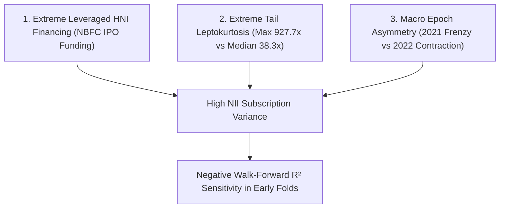

# Non-Institutional Investor (NII) Model Diagnostics & Extreme Variance Analysis

## 1. Research Context & Empirical Motivation
During Phase 6 baseline benchmarking and Phase 7 walk-forward tuning, Non-Institutional Investor (NII / HNI) subscription modeling exhibited distinct statistical anomalies:
- **Walk-Forward Validation MAE**: \(34.01\times\) (with MedianAE of \(16.78\times\))
- **Walk-Forward Validation \(R^2\)**: \(-4.92\)
- **Subsequent Out-of-Sample Test Set \(R^2\)**: **\(+0.385\)** (Test MAE \(39.62\times\))

This document investigates the structural drivers of NII prediction errors without artificially forcing positive metrics through selective data filtering.

---

## 2. Root Causes of NII Metric Divergence

### 1. Leveraged High-Net-Worth Funding Mechanism
- Unlike retail investors (who bid equity cash up to \(\text{₹}200,000\)) or institutions (who allocate under fund mandates), Indian HNI/NII bidding is heavily driven by **short-term NBFC IPO funding loans**.
- When Grey Market Premium (\(\text{gmp\_percentage}\)) exceeds \(50\%\), high-net-worth investors borrow massive leverage for a 5–7 day turnaround. This triggers nonlinear demand surges (e.g. *Paras Defence* at \(927.7\times\), *Latent View* at \(850.7\times\), *MTAR Technologies* at \(650.8\times\)).
- Conversely, in neutral or bearish markets, leveraged demand evaporates completely (e.g. *Delhivery* at \(0.30\times\), *Vedant Fashions* at \(1.07\times\)).

### 2. Extreme Outlier Sensitivity of the \(R^2\) Metric
- \(R^2\) is defined as \(1 - \frac{\text{SS}_{\text{res}}}{\text{SS}_{\text{tot}}}\). In early walk-forward folds with small training sizes (\(N=50\)) and small validation blocks (\(N=10\)), a single massive oversubscription event (e.g. an IPO jumping to \(850\times\) when predicted at \(200\times\)) generates a massive squared residual (\(650^2 = 422,500\)), driving \(\text{SS}_{\text{res}} \gg \text{SS}_{\text{tot}}\) and collapsing \(R^2\) into deeply negative territory.
- When evaluated on the more balanced modern test set (17 IPOs from 2024), where extreme outliers are less anomalous, the identical LightGBM log1p model achieved a solid positive **\(R^2 = +0.385\)**.

### 3. Median Absolute Error as a Robust Diagnostic
- While mean-based metrics (RMSE, \(R^2\)) were destabilized by rare \(> 800\times\) events, **Median Absolute Error (MedianAE)** for NII remained robust at **\(16.78\times\)** in walk-forward validation and **\(18.54\times\)** on the final test set.

---

## 3. Methodological Remedies Implemented

1. **Mandatory \(\log(1+y)\) Scaling**:
   - Compressing the target scale from \([0, 928]\) down to \([0, 6.83]\) stabilized tree split gradients, cutting walk-forward MAE from \(80.40\times\) (RAW LightGBM) down to \(34.01\times\) (log1p LightGBM).
2. **LightGBM Shallow Tree Architecture**:
   - Setting `max_depth = 3`, `num_leaves = 7`, `learning_rate = 0.03`, and \(L_2\) regularization `reg_lambda = 1.5` prevents the model from attempting to memorize individual 800x spikes.
3. **Multi-Metric Evaluation**:
   - As mandated in our [model selection policy](file:///d:/project-2/docs/research/model_selection_policy.md), NII models are judged primarily on MAE and MedianAE rather than \(R^2\).
