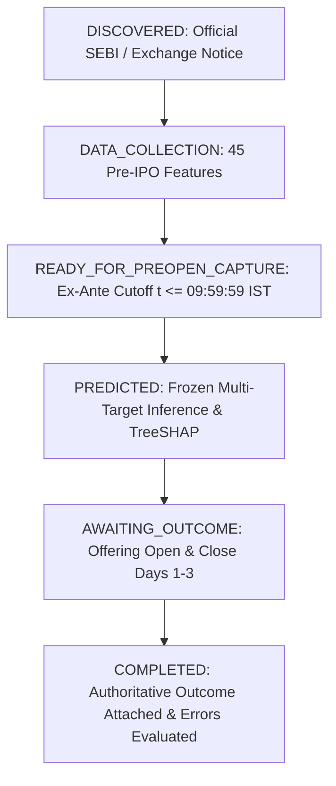

# Methodological Research Protocol: Multi-IPO Prospective Validation Governance

## 1. Objective & Scientific Rationale
The primary vulnerability of machine learning applications in financial book-building is **look-ahead leakage** and **retrospective overfitting**. Standard cross-validation and historical backtesting, while necessary, cannot replicate the real-time informational constraints of live trading. 

This protocol codifies the operational governance rules for **Prospective Out-of-Sample Validation** across all upcoming Indian Mainboard Initial Public Offerings (IPOs).

---

## 2. Prospective Offering Lifecycle

### Lifecycle State Invariants:
1. **`DISCOVERED`**: Issue identified from official exchange notices. Validates Mainboard listing criteria (SME issues excluded).
2. **`DATA_COLLECTION`**: Automated aggregation of 45 pre-IPO predictive features from statutory RHP filings, peer metrics, and secondary market indices.
3. **`READY_FOR_PREOPEN_CAPTURE`**: Verification that all observations strictly precede $t_{\text{cutoff}} = \text{09:59:59 IST}$ on the opening date. Generation of immutable SHA-256 snapshot.
4. **`PREDICTED`**: Cryptographic pre-flight verification of the 5 frozen candidate models, inference generation, and append-only ledger logging.
5. **`AWAITING_OUTCOME`**: Lock on prediction state throughout the 3-day bidding window. Strictly prohibits retroactive adjustment.
6. **`COMPLETED`**: Attachment of authoritative closing tallies from NSE / BSE, computation of absolute errors, signed bias, APE, category accuracy, and confidence calibration.

---

## 3. Strict Non-Retraining & Freezing Policy
* **Frozen Model Artifacts:**
  - Total Subscription: XGBoost ($\log1p \to \text{expm1}$)
  - QIB Subscription: Random Forest (RAW)
  - NII Subscription: LightGBM ($\log1p \to \text{expm1}$)
  - Retail Subscription: XGBoost (RAW)
  - Preprocessor: `dev_preprocessor.joblib`
* **Zero Model Mutation:** No hyperparameter tuning, model re-estimation, or feature selection is permitted based on prospective validation performance.
* **Integrity Enforcement:** Before every prediction, the engine computes SHA-256 digests for all 5 serialized files. Any discrepancy triggers a `MODEL_INTEGRITY_FAILURE` halt.

---

## 4. Population Stability Index (PSI) Drift Surveillance

$$\text{PSI} = \sum_{i=1}^{k} \left( P_i - Q_i \right) \times \ln\left( \frac{P_i}{Q_i} \right)$$

* $\text{PSI} < 0.10$: **`LOW DRIFT`** (In-distribution, model stable).
* $0.10 \le \text{PSI} < 0.25$: **`MODERATE DRIFT`** (Monitored warning status).
* $\text{PSI} \ge 0.25$: **`HIGH DRIFT`** (`MODEL_REVIEW_REQUIRED`).
* *Governance Rule:* High drift triggers human quantitative review; automatic model retraining is strictly prohibited.

---

## 5. Statistical Interpretation & Sample Size Progression
* Individual offerings ($N=1$, e.g., Lumino Industries Ltd) are classified strictly as **Prospective Case Studies**.
* Statistical claims of generalized domain invariance require prospective sample accumulation across distinct macroeconomic regimes ($N \ge 25$).
