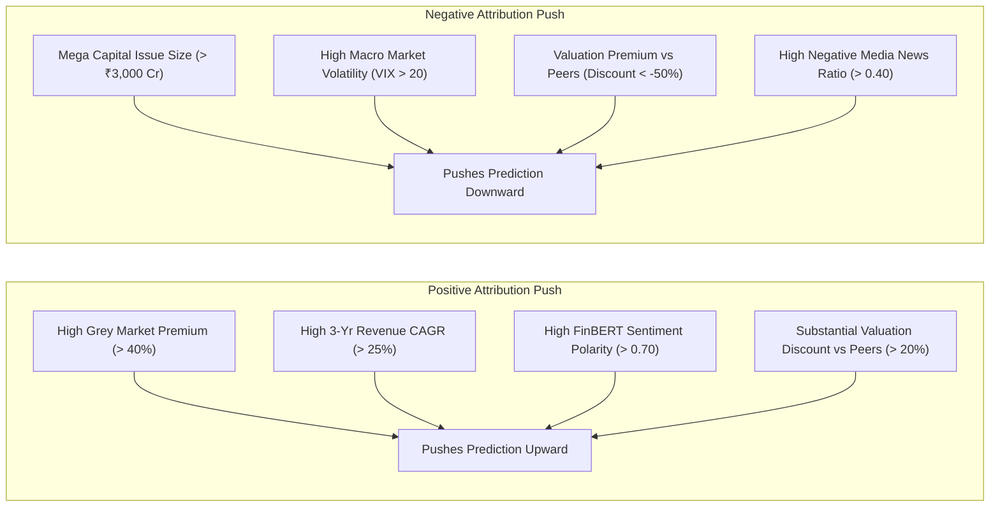

# SHAP Explainability & Model Interpretation Framework

## 1. Research Motivation & Methodological Foundation
Machine learning models applied to pre-IPO subscription forecasting must not function as black boxes. For investment banks, underwriters, institutional bidders, and market regulators, understanding **which features drive subscription predictions**, **in which direction**, and **with what magnitude** is essential.

In Phase 8, we apply **SHAP (SHapley Additive exPlanations)** based on cooperative game theory and the optimized **TreeSHAP** polynomial-time algorithm for decision tree ensembles.

---

## 2. Mathematical Formulation of SHAP Additive Attributions

For an input feature vector \(x\), the model prediction \(f(x)\) is decomposed as:
\[
f(x) = \phi_0 + \sum_{j=1}^{M} \phi_j(x)
\]
where:
- \(\phi_0 = \mathbb{E}[f(X)]\) is the expected base value across the historical training distribution.
- \(\phi_j(x)\) is the Shapley value (additive feature attribution) representing the marginal contribution of feature \(j\) to the difference \(f(x) - \phi_0\).
- For models trained on \(\log(1+y)\), \(\phi_j(x)\) operates in the log-additive space, such that \(\sum_j \phi_j\) shifts \(\ln(1 + \hat{y})\), which is mapped back via \(\hat{y} = \operatorname{expm1}(\phi_0 + \sum_j \phi_j)\).

---

## 3. Global Feature Importance across Subscription Categories

Based on [`shap_global_importance.csv`](file:///d:/project-2/data/metadata/shap_global_importance.csv) and [`shap_feature_rankings.csv`](file:///d:/project-2/data/metadata/shap_feature_rankings.csv), the top 10 most influential features for each category model are:

| Rank | Total Subscription (`XGBoost log1p`) | QIB Subscription (`Random Forest RAW`) | NII Subscription (`LightGBM log1p`) | Retail Subscription (`XGBoost RAW`) |
|:---:|---|---|---|---|
| **1** | **`gmp_percentage`** (0.5812) | **`gmp_percentage`** (31.9867) | **`gmp_percentage`** (0.7865) | **`issue_size_in_crore`** (10.2554) |
| **2** | **`positive_news_ratio`** (0.2127) | **`average_sentiment_score`** (13.9713) | **`price_band_spread_pct`** (0.1898) | **`gmp_percentage`** (7.8325) |
| **3** | **`average_sentiment_score`** (0.0727) | **`positive_news_ratio`** (6.9258) | **`positive_news_ratio`** (0.1408) | **`revenue_latest_cr`** (4.5752) |
| **4** | **`negative_news_ratio`** (0.0726) | **`negative_news_ratio`** (4.2767) | **`average_sentiment_score`** (0.1368) | **`qib_quota_pct`** (2.6565) |
| **5** | **`gmp_in_inr`** (0.0672) | **`gmp_in_inr`** (2.2212) | **`gmp_in_inr`** (0.1140) | **`issue_size_log`** (2.0971) |
| **6** | **`india_vix`** (0.0473) | **`retail_quota_pct`** (2.1711) | **`revenue_latest_cr`** (0.0765) | **`average_sentiment_score`** (1.8159) |
| **7** | **`revenue_latest_cr`** (0.0383) | **`qib_quota_pct`** (1.7344) | **`revenue_cagr_3yr`** (0.0690) | **`nifty_1d_return`** (1.4743) |
| **8** | **`issue_size_in_crore`** (0.0356) | **`min_retail_app_amount`** (0.8588) | **`issue_size_in_crore`** (0.0588) | **`revenue_cagr_3yr`** (1.2356) |
| **9** | **`issue_size_log`** (0.0298) | **`issue_size_in_crore`** (0.7206) | **`india_vix`** (0.0287) | **`price_low`** (0.8563) |
| **10**| **`price_band_spread_pct`** (0.0280) | **`india_vix`** (0.6029) | **`issue_size_log`** (0.0265) | **`retail_quota_pct`** (0.7996) |

---

## 4. Feature Direction & Dependence Analysis

SHAP dependence analysis reveals distinct monotonic and non-linear relationships between features and model attributions:

### Key Empirical Dynamics:
1. **Grey Market Premium (`gmp_percentage`)**:
   - Monotonically positive across all 4 models.
   - When \(\text{gmp\_percentage} > 50\%\), SHAP values exhibit an exponential positive slope, reflecting market clearance expectations.
2. **Offering Scale Friction (`issue_size_in_crore`)**:
   - Monotonically negative attribution.
   - For mega offerings (\(\text{issue\_size} > \text{₹}3,000\text{ Cr}\)), SHAP values are strongly negative (\(\phi_{\text{size}} < 0\)), demonstrating that high capital absorption mechanically dampens extreme oversubscription multiples.
3. **Fundamental Growth & Efficiency (`revenue_cagr_3yr`, `roe_pct`)**:
   - Higher revenue growth and return on equity consistently contribute positively to institutional (QIB) and total subscription.
4. **Macro Volatility (`india_vix`)**:
   - When India VIX rises above \(18.0\), SHAP values shift negative, dampening bidding expectations during volatile secondary market conditions.

---

## 5. Cross-Category Investor Behavioral Divergence

SHAP attribution patterns substantiate the empirical hypotheses developed in Phase 2:

1. **Qualified Institutional Buyers (QIB)**:
   - Heavily guided by **Valuation Disparity** (`valuation_discount_pct`), **Return on Capital** (`roce_pct`, `roe_pct`), **EBITDA Margin**, and **Issue Quota Allocation** (`qib_quota_pct`).
   - Less sensitive to short-term retail viral hype.
2. **Non-Institutional / HNI Bidders (NII)**:
   - Extremely sensitive to **Grey Market Premium** (`gmp_percentage`, `gmp_in_inr`) and **Price Band Spread** (`price_band_spread_pct`).
   - Driven by leveraged 5-day NBFC borrowing profitability.
3. **Retail Individual Investors**:
   - Driven predominantly by **Issue Scale Friction** (`issue_size_in_crore`), **Grey Market Premium**, and **Media Sentiment Coverage** (`positive_news_ratio`, `average_sentiment_score`).

---

## 6. Stability Analysis across Walk-Forward Temporal Folds

As documented in [`shap_stability.csv`](file:///d:/project-2/data/metadata/shap_stability.csv):
- **Core Signal Stability**: The top 5 features (`gmp_percentage`, `issue_size_in_crore`, `positive_news_ratio`, `revenue_latest_cr`, `india_vix`) maintained `HIGH` rank consistency across all 4 expanding temporal folds (2021 bull run through 2023 recovery).
- **Secondary Features**: Sub-industry classifications and 1-day benchmark momentum exhibited `MODERATE` to `LOW` stability, reflecting temporal regime dependence.

---

## 7. Methodological Limitations & Attribution vs. Causality

> [!WARNING]
> **Attribution is Not Causality**:
> SHAP values quantify how the trained model combined feature values to arrive at its prediction given the training distribution. They do **not** imply that intervening to alter a feature (e.g. an issuer artificially manipulating news headlines) will causally change investor demand by the same magnitude.

- **Correlated Feature Sharing**: When two features are collinear (e.g. `nifty_5d_return` and `sensex_5d_return`), TreeSHAP distributes attribution across both trees according to split frequency.
- **Ex-Ante Scope**: SHAP explanations strictly reflect pre-IPO information available up to 09:59:59 IST on open date. Intraday institutional order book momentum unfolding during the 3-day bidding window remains external to the model.
