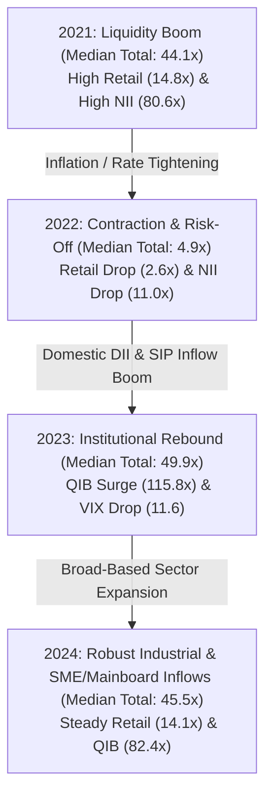

# Temporal Distribution Analysis & Macro Regime Dynamics

## 1. Overview
Financial markets operate under evolving macroeconomic regimes, interest rate cycles, and liquidity conditions. A core premise of this research is that IPO subscription dynamics are non-stationary across time. 

This document details the chronological evolution of the **106 verified Indian Mainboard IPOs** across 4 distinct market epochs from **January 2021 through July 2024**.

---

## 2. Chronological Regime Breakdown

| Listing Epoch | Macro Regime Characteristics | IPO Count | Median QIB (\(\times\)) | Median NII (\(\times\)) | Median Retail (\(\times\)) | Median Total (\(\times\)) | Median VIX |
|---|---|:---:|:---:|:---:|:---:|:---:|:---:|
| **2021** | **Post-COVID Global Liquidity Surge & Tech Boom** | 34 | 77.53 | 80.63 | 14.85 | 44.11 | 21.80 |
| **2022** | **Global Rate Hikes, Geopolitical Shock & Tech Correction** | 24 | 14.80 | 11.00 | 2.64 | 4.88 | 18.30 |
| **2023** | **Domestic Economic Recovery & Small/Mid-Cap Inflow Surge** | 28 | 115.78 | 47.08 | 12.00 | 49.91 | 11.60 |
| **2024 (H1)** | **Manufacturing, Defence & Capital Goods Exuberance** | 20 | 82.42 | 48.46 | 14.10 | 45.47 | 14.55 |

---

## 3. Regime Transitions & Structural Distribution Shifts

### Key Analytical Observations:
1. **The 2022 Contraction Shock**:
   - Following global interest rate hikes, inflation pressures, and the geopolitical conflict in Europe, median total subscription collapsed by **\(88.9\%\)** from \(44.11\times\) in 2021 to \(4.88\times\) in 2022.
   - Retail participation plunged from a median of \(14.85\times\) to \(2.64\times\), and mega-cap offerings (e.g. *LIC of India* at \(2.95\times\), *Delhivery* at \(1.63\times\)) experienced subdued demand.
2. **The 2023–2024 Institutional Rebound**:
   - Institutional (QIB) bidding rebounded sharply in 2023, hitting an all-time record median of \(115.78\times\), driven by strong mutual fund inflows, corporate earnings growth, and low market volatility (median VIX of \(11.60\)).
   - 2024 continued this positive momentum with balanced participation across Industrials, Electronics, and Healthcare sectors.

---

## 4. Sector Dynamics Across Regimes

| Sector | Observation Count | Dominant Epoch | Median QIB (\(\times\)) | Median NII (\(\times\)) | Median Retail (\(\times\)) | Median Total (\(\times\)) |
|---|:---:|:---:|:---:|:---:|:---:|:---:|
| **Industrials** | 22 | 2023–2024 | 123.80 | 75.95 | 19.50 | 80.65 |
| **Materials / Chemicals** | 18 | 2021–2022 | 87.84 | 148.32 | 12.60 | 73.91 |
| **Information Technology** | 16 | 2021–2023 | 91.18 | 41.51 | 14.37 | 55.62 |
| **Consumer Discretionary**| 19 | 2021–2024 | 77.53 | 34.47 | 10.99 | 38.90 |
| **Healthcare / Pharma** | 14 | 2021–2024 | 49.16 | 19.11 | 5.48 | 26.50 |
| **Financial Services** | 13 | 2021–2024 | 28.64 | 18.35 | 3.66 | 17.37 |
| **Real Estate** | 4 | 2021–2024 | 12.71 | 7.49 | 3.84 | 6.62 |

---

## 5. Chronological Partitioning Implications for Modeling

To prevent **lookahead bias** and simulate realistic production forecasting, our chronological partition strictly assigns historical windows:
- **Training Set (\(N=74\))**: `2021-01-18` to `2023-10-30` (Spans both the 2021 bull run, the 2022 bear correction, and the early 2023 recovery).
- **Validation Set (\(N=15\))**: `2023-10-31` to `2024-01-30` (Spans the late 2023 mega IPO surge including *Tata Technologies*, *DOMS*, *IREDA*).
- **Test Set (\(N=17\))**: `2024-02-07` to `2024-07-03` (Strictly forward-out-of-sample evaluation on modern 2024 offerings).

This temporal split guarantees that models are tested on a regime distinct from earlier training data, rigorously testing generalization capabilities under distribution shifts.
